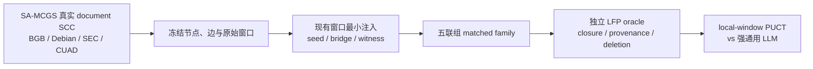

# LFP-MCGS 数据设计：真实 SCC 上的受控证明注入

> 更新：2026-08-19<br>
> 当前决策：不再寻找一个“天然同时具备长 SCC、分散原文、Horn gold 和自然风险标签”的完美现成数据集。先沿用 SA-MCGS 的真实图载体，建立可解释、可执行、成对的 topology-controlled intervention；现成数据分别承担真实外测和 symbolic safety。

## 0. 先看结论

主数据不是纯 synthetic cycle，也不是把 Paper 1 的风险标签换个名字。它由三部分组成：



数据证据分层：

1. **核心机制集：**真实 SCC + 受控证明注入；
2. **真实无注入外测：**只验证 interface 和方向一致性，不估计自然总体频率；
3. **symbolic safety：**ProofWriter/RobustLR 等检查 LFP、proof 与逻辑编辑；
4. **无环组合控制：**MuSiQue 或 matched DAG 检查收益是否只是普通多跳。

---

## 1. 为什么这比“只做 ProofWriter”更合适

Paper 2 的科学问题不是 LLM 会不会在一组已给定规则上跑 Datalog，而是：

> 证据被分散在真实循环文档的局部窗口中时，通用 LLM 能否通过 SCC-aware slow thinking 找齐它们，并让新 closure 改变下一步搜索？

ProofWriter 能给 exact program/proof，却没有 SA-MCGS 的真实 document topology 和付费局部读取压力；法律、合同与软件图有真实 SCC，却没有现成 Horn proof gold。受控干预正好把两者连接起来：**真实载体保持不变，形式 gold 由最小语义注入产生。**

这也与 Paper 1 一致：Paper 1 在真实 SCC 上构造远端联合风险；Paper 2 构造远端联合证明。区别是 Paper 2 的 gold 可以由 LFP executor 完整复核。

---

## 2. Carrier SCC 选择

优先从现有 SA-MCGS 数据管线筛选：

| 来源 | 可复用资产 | 在 Paper 2 中的角色 | 风险 |
|---|---|---|---|
| BGB / QuantLaw | 真实法条、交叉引用、既有 local windows | 首选法律 carrier；可展示长引用 SCC 中的慢思考 | citation cycle 不等于 semantic recursion，必须由注入程序另建语义 gold |
| Debian | 真实 package/source metadata 与依赖 SCC | 结构差异大的第二 carrier | alternatives、版本和 conflicts 不能粗暴当 positive-Horn 边 |
| SEC EX-21 | 真实公司披露/实体关系窗口 | 外域 carrier 候选 | 实体解析或聚合可能产生伪环，须重新审计 |
| CUAD / contracts | 真实合同与律师监督 clause spans | 真实长文本与 source-grounding 候选 | 没有权威原生 SCC；只有经审计的关系图才可进入核心 |

资格 Gate：

- 非平凡 directed SCC；
- window source 可稳定重建；
- 节点数可覆盖至少三个目标档位；
- 不依赖 gold query 才能构图；
- 文本许可和发布方式清楚；
- 注入后仍能自然地嵌入原窗口，不需要整段重写。

未通过 Gate 的数据只能作 appendix case，不为了凑域数强行进入主表。

---

## 3. 注入协议

### 3.1 冻结项

每个 carrier case 固定：

- SCC node IDs 与 directed edges；
- 原始 source records / windows；
- window 切分与 retrieval metadata；
- query 之外的非目标文本；
- split、domain、topology hash 与随机种子。

不允许通过新增边或复制节点制造 MCGS 优势。

### 3.2 最小语义注入

只在现有窗口中追加一到两句领域化文本：

```text
seed window:     给出 grounded base fact
bridge windows:  给出需要前一结果才能触发的 Horn rules
witness window:  给出 query-critical rule / fact
```

例如在一个 12 节点 SCC 中，proof-carrying windows 可以是 5 个，其余 7 个保持真实 distractors。query 的证明必须跨多个 source；任何单窗口都不得直接泄露答案。

### 3.3 五联组

| 版本 | 构造 | 预期标签 |
|---|---|---|
| Productive | 正确 seed、bridges、witness 全部存在 | Entailed，且有跨来源 proof |
| Decoy | 最小替换 seed 实体/guard/极性 | Unknown / Not Entailed |
| Broken-or-Inactive | 在该 paired variant 中省略或用 no-op 替换拟注入的必要 bridge，或让环与 query 无关；不删除原始窗口内容 | Unknown；不能盲目把 SCC 当证据 |
| Clean | 保留原始 SCC，不做目标语义注入 | 由预注册 clean protocol 决定；主看误报 |
| Matched-DAG | 另行构造物理 document-topology 对照；保持窗口、来源、规则、proof depth 与 label 一致，只打断 document feedback edge | 隔离 document-SCC effect；不把 document cycle 冒充 semantic recursion |

不把正例与负例写成明显不同句式；同一 family 的成员必须进同一 split。前四个 SCC 条件共享冻结的物理拓扑；Matched-DAG 是单独的 topology control，不属于“只改窗口文本”的干预条件。

### 3.4 尺寸与难度

```text
document-SCC nodes = 3 / 5 / 7 / 9 / 12 / 16 / 20
```

同时记录以下独立变量：

- proof-carrying windows；
- minimum acquisition cover；
- fixed-point rounds；
- seed–witness shortest-path distance；
- distractor ratio；
- SCC density 和可替代路径；
- 每窗口 tokens 与全案 tokens。

`3–5` 主要调通；`7–9` 对齐 SA-MCGS 已观察到的复杂度转折；`12–20` 检验通用 LLM 是否无法靠一次全局扫描稳定解出。不要用“20 节点”本身定义很难，真正难度必须由 proof distance、证据覆盖与实测错误共同说明。

---

## 4. Exact gold 与可解释性

每个 case 由两个相互独立的 positive-Horn evaluator 复核：

1. full least fixed point；
2. 每轮新增 atoms；
3. query proof DAG；
4. atom/rule 到 source span 的 provenance；
5. minimum acquisition cover；
6. 删除每个必要 source 后的 query 与 closure；
7. 无 seed SCC 的空启动 invariant；
8. matched family 中唯一预期变化。

语言侧另做盲审：标注者不知道条件，检查文本是否连贯、注入句是否符合领域表达、单窗口是否泄露答案、实体是否与原文冲突。形式正确和语言自然必须分开报告。

推荐发布 manifest：

```text
carrier_case_id
scc_nodes / edges / source_ids
original_text_hash
condition
injected_spans
seed / bridge / witness roles
gold_program
closure_rounds
proof_dag
minimum_source_cover
deletion_oracle
template_family / entity_family / random_seed
```

---

## 5. 防止“注入痕迹分类”

- seed、bridge、witness 的位置在 SCC 上轮换；
- 每种 condition 共享相同长度、标点和领域关键词分布；
- 加入 no-op paraphrase，检查“看见新句子就判正”的策略；
- template、entity、carrier topology 三层 held-out；
- `single-window only`、`injected-span only` 与 bag-of-words classifier 必须接近机会水平；
- matched positive/negative 的自然性盲审分数应接近；
- clean SCC 单列 false-positive rate；
- 不让被测模型或同一模型家族生成 gold 和评测题。

[CAD limitation](https://aclanthology.org/2022.acl-long.256/) 已表明干预多样性不足可能保留或强化伪相关，因此多模板与 family-level split 是主实验必要条件，不是 appendix decoration。

---

## 6. 现成数据的正确角色

| 数据 | 当前角色 | 不能承担的 claim |
|---|---|---|
| [ProofWriter](https://aclanthology.org/2021.findings-acl.317/) | exact LFP/proof、seeded/unseeded 与 parser sanity | 真实循环文档上的 MCGS 优势 |
| [RobustLR](https://aclanthology.org/2022.emnlp-main.653/) | 最小逻辑编辑与等价改写 robustness | 自然 long-SCC 分布 |
| [MuSiQue](https://aclanthology.org/2022.tacl-1.31/) | 跨来源组合与 disconnected-reasoning control | recursive closure 或 SCC 因果 |
| CLUTRR / StepGame / SpaRTUN | 关系/空间 closure executor 与语言变化 | latent rules、真实 document SCC |
| AOP-Wiki / SIGNOR | 有 provenance 的真实 feedback case | 原生 QA/proof benchmark或法律结论 |
| Debian `dose/botch` | solver 与图结构 sanity | pure positive-Horn 自然语言主任务 |

这些数据分表回答不同问题，不做跨 semantic profile 的 Closure-F1 总平均。

---

## 7. 历史审计数字：只作资产记录

此前实测仍保留，但已降为历史诊断：

- ProofWriter OWA D5：`2,778` 个 ground-instance-causal theories、`24,169` 个 causal queries；
- ParaRules：`1,679` 个 causal theories、`8,723` 个 causal queries；
- CLUTRR：`3,977 / 3,977` query 可由独立 closure 重算；
- StepGame：100k noisy test 中 `78,777` 个 fully canonical；
- SpaRTUN/SpaRP：`48,246` questions，`25,112` 个 gold-chain length≥2。

它们证明 executor、proof 和 source-selection 资产可用；不能替代当前真实 SCC intervention，也不能用来声称 MCGS 已经优于通用 LLM。

---

## 8. 数据 Go / No-Go

### GO

- 每个 size 档至少有足够多独立 carrier SCC families；
- 两个 executor 对所有 case 的 label、closure 和 proof 完全一致；
- productive 的必要 source 删除后 100% 失败；
- decoy/broken/inactive 不发生 circular self-support；
- single-window/injection-only shortcut 接近机会水平；
- 盲审认为注入与领域上下文基本自然；
- 至少一个真实无注入 block 可以跑完整 pipeline。

### NO-GO / 回退

- 长 SCC 数量不足，则保留 `3–12` 的自然 carrier，`16–20` 只作透明 stress；
- 注入模板可被表面分类器识别，则增加模板和人工改写后重做 split；
- matched-DAG 无法匹配 proof depth/长度，则不做 cycle 因果 claim；
- clean SCC 误报过高，则先解决 parser/validator，不扩大数据；
- 自然无注入 case 太少，则明确论文是 controlled mechanism paper，不虚构自然分布结论。

最终数据口径：

> **真实 SCC 提供搜索环境；最小注入提供可证伪机制；exact LFP 提供 gold；clean 与自然外测限制 claim。**
