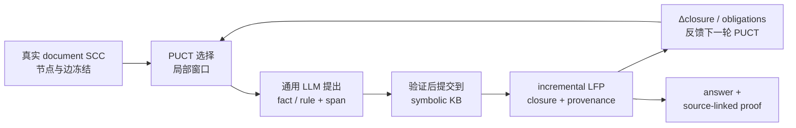

# Paper 2 研究方案：旧初稿归档

> 本文件原为 1,000 行以上的探索草案，其中包含已经放弃的 ProofWriter-first、TreeMCTS 主 baseline、synthetic SCC 主实验和“强推翻”表述。为避免与当前方案冲突，旧口径已收拢，不再保留第二套执行计划。

当前唯一执行版：[`LFP_MCGS_RESEARCH_PLAN_V2.md`](./LFP_MCGS_RESEARCH_PLAN_V2.md)

## 当前口径摘要

- 继承 SA-MCGS 的真实循环文档、local-window reads 与 AlphaGo-style PUCT；
- local window 仍是读取原文的接口；LFP 取代的是旧的局部风险软记忆，成为跨读取积累的知识状态与反馈信号；
- 核心机制集冻结真实 SCC 拓扑，只在现有窗口中最小注入 `seed / bridge / witness`；
- 每个 family 包含 `Productive / Decoy / Broken-or-Inactive / Clean / Matched-DAG`；
- SCC 节点数覆盖 `3 / 5 / 7 / 9 / 12 / 16 / 20`；
- gold 由独立 LFP 引擎生成，包括逐轮 closure、provenance、最小来源集与 deletion oracle；
- 主 baseline 是 matched-compute 强通用 LLM；TreeMCTS 只关闭 exact state merge；
- 人工注入只证明受控机制，不证明自然分布；
- positive Horn 不撤回已成立事实，不主张“强推翻”。

## 历史材料在哪里

- V1–V3 的冻结配置、数字和限制保存在 [`experiments/`](./experiments/)；
- 早期数据候选与实测统计已收拢到 [`LFP_MCGS_DATASET_ANALYSIS.md`](./LFP_MCGS_DATASET_ANALYSIS.md) 和 [`LFP_MCGS_DATASET_AUDIT.md`](./LFP_MCGS_DATASET_AUDIT.md)；
- 新颖性与受控干预文献见 [`LFP_MCGS_LITERATURE_REVIEW.md`](./LFP_MCGS_LITERATURE_REVIEW.md)。

历史结果可以解释路线演化，但不进入 Paper 2 的摘要、主表或当前 Go/No-Go。
